# Cursors

My cursor theme repository. Every theme is built from committed sources by one
builder, producing an Xcursor theme and, where the theme supports it, a
Hyprland (hyprcursor) theme.

## Layout

```
themes/<theme>/
  theme.json    cursor list: per-frame size, hotspot, delay; alias map; names
  <hash>.png    one file per unique animation frame, exactly the pixels the
                Xcursor file stores
```

`theme.json` is the single source of truth. Frames are stored in PNG form as the
exact RGBA bytes an Xcursor image chunk holds, so nominal size always equals the
bitmap size and consumers never rescale a cursor. Alias names are plain
symlinks, so the whole theme costs one copy of each image.

`scripts/build-theme.sh` turns a theme directory into either output; the flake
calls it once per package. Deepin, Earendil, Popucom, Raccoin and SSB frames
were extracted once from the previously committed binaries, which are gone.

## Packages

Combined packages install the matching Xcursor and Hyprcursor outputs and expose
cursor metadata through `passthru`:

- `deepin-dark`, `deepin-light`
- `earendil-dark`, `earendil-light`
- `popucom-<colour>`
- `raccoin`, `raccoin-<variant>`
- `ssb` (Xcursor only)

```nix
let
  theme = inputs.cursors.packages.${pkgs.system}.popucom-cyan;
in {
  environment.systemPackages = [ theme ];
  environment.sessionVariables = theme.mkCursorSessionVariables {
    xcursorSize = 24;
    hyprcursorSize = 24;
  };
}
```

Useful attrs: `cursorPackages`, `cursorSessionVariables`,
`mkCursorSessionVariables`, `xcursorThemeName`, `hyprcursorThemeName`,
`gtkCursorSettings`, `mkGtkCursorSettings`.

### Individual outputs

- `deepin-dark-xcursor`, `deepin-dark-hyprcursor`
- `deepin-light-xcursor`, `deepin-light-hyprcursor`
- `earendil-dark-xcursor`, `earendil-dark-hyprcursor`
- `earendil-light-xcursor`, `earendil-light-hyprcursor`
- `popucom-<colour>-xcursor`, `popucom-<colour>-hyprcursor`
- `raccoin-<variant>-xcursor`, `raccoin-<variant>-hyprcursor`
- `raccoin-xcursor`, `raccoin-hyprcursor` (aliases for the `default` variant)
- `ssb-xcursor`

Popucom colours: `pink`, `green`, `blue`, `yellow`, `red`, `orange`, `cyan`,
`purple`, `grey`, `black`, `inverted`. Raccoin variants: `default`, `dark`,
`bw`, `black-outline`.

## Credits

- `deepin-*` - Deepin cursor artwork
- `earendil-*` - Earendil website cursor, https://earendil.com (source asset
  `_static/cursor-dark.svg` / `_static/cursor-light.svg` from
  https://github.com/earendil-works/website)
- `popucom-*` - Popucom cursor artwork
- `raccoin-*` - Raccoin cursor artwork
- `ssb-*` - Super Smash Bros Ultimate cursor artwork

<!-- previews:start -->
## Previews

Generated with `scripts/generate-readme-previews.py`.

| Deepin-Dark-xcursor | Deepin-Light-xcursor |
| --- | --- |
| 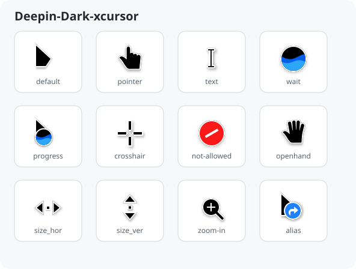 | 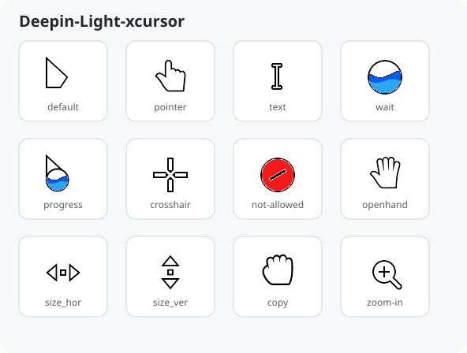 |

| Earendil-Dark-xcursor | Earendil-Light-xcursor |
| --- | --- |
| 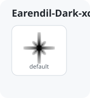 | 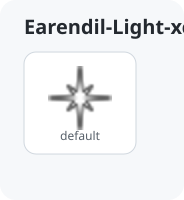 |

| Popucom-Black-xcursor | Popucom-Blue-xcursor |
| --- | --- |
| 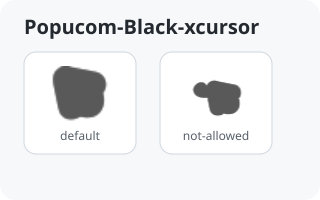 | 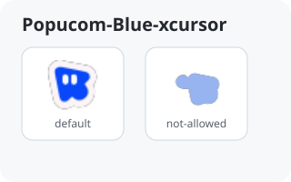 |

| Popucom-Cyan-xcursor | Popucom-Green-xcursor |
| --- | --- |
| 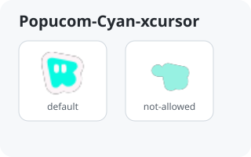 | 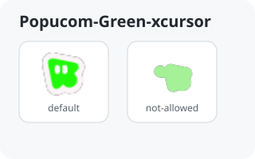 |

| Popucom-Grey-xcursor | Popucom-Inverted-xcursor |
| --- | --- |
| 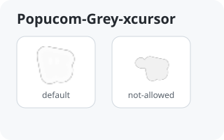 | 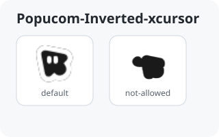 |

| Popucom-Orange-xcursor | Popucom-Pink-xcursor |
| --- | --- |
| 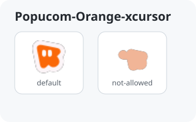 | 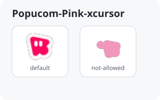 |

| Popucom-Purple-xcursor | Popucom-Red-xcursor |
| --- | --- |
| 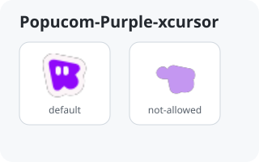 | 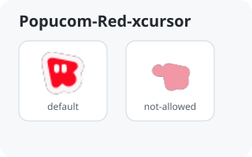 |

| Popucom-Yellow-xcursor | Raccoin-Default-xcursor |
| --- | --- |
| 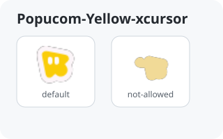 | 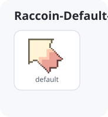 |

| Raccoin-Dark-xcursor | Raccoin-BW-xcursor |
| --- | --- |
| 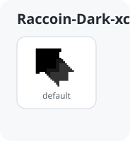 | 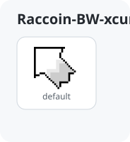 |

| Raccoin-Black-Outline-xcursor | SSB-xcursor |
| --- | --- |
| 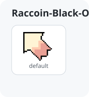 | 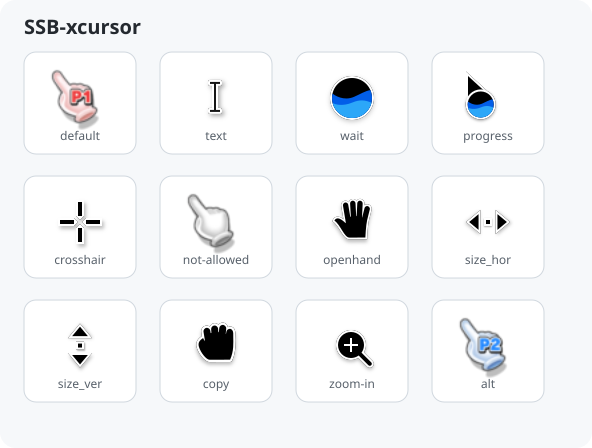 |

<!-- previews:end -->
